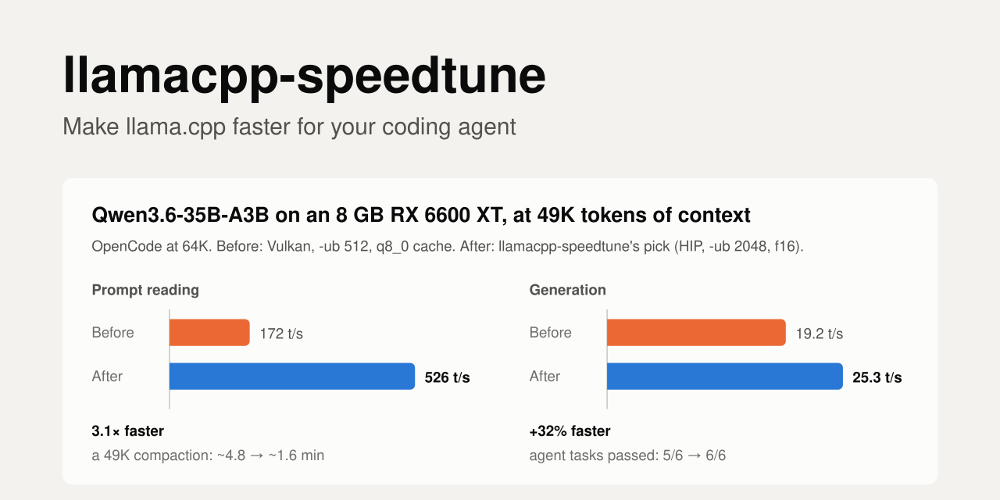

# local-llm-speedtune

**Make your local LLMs as fast as your hardware allows, for your coding agent.** An agent skill that has your coding agent (Claude Code, OpenCode, Codex, …) pick the best **engine**, then the best **backend**, then the best **flags** for *your* hardware, measured at the context depths agents really use and checked on real agent tasks. It asks its questions up front, tells you when it'll be done, and runs while you're away.

<p align="center"></p>

Most tuning advice is measured on an empty context with one short prompt. Coding agents don't work like that: every turn resends 12K+ tokens of system prompt and tools plus the whole conversation, and they compact near the end of the context. A config that wins at depth 0 can lose badly at 48K. This skill measures at your agent's real context depths, confirms that configs fit in a real server, and checks the result on real agent tasks.

**llama.cpp** is the default engine: it runs everywhere, on CUDA, HIP/ROCm, Vulkan, Metal or CPU, and it can split a model between GPU and RAM. Where the hardware gives another engine a real chance (ExLlama on NVIDIA when the model fits in VRAM, MLX on Apple Silicon, ik_llama.cpp for MoE models in RAM, OpenVINO on Intel), the skill tries it, and keeps it only if it wins by measurement: [engines](references/engines.md). Ollama users can tune within Ollama or take the result with them: see [Ollama](#ollama).

## Start with the 2-minute check

No setup, no benchmarks, nothing changed. It reads your current settings and points out likely speed left on the table:

```bash
git clone https://github.com/cliffkoome/local-llm-speedtune && cd local-llm-speedtune/scripts
./quick_check.py --router http://127.0.0.1:8080          # a llama-server router (key from $LLAMA_API_KEY)
./quick_check.py --preset ~/models/presets.ini           # or a presets file
./quick_check.py --args "-m model.gguf -c 32768 -ngl 99"  # or one command line
./quick_check.py --ollama                                # or your Ollama models and settings
```

```text
== qwen3.6-35b-a3b  (qwen35moe, MoE 8/256 experts, 40 layers, 20.6 GB)
   [big   ] Small batch size with experts in RAM
            With CPU experts, ubatch 512 -> 2048 nearly doubled prompt speed in the worked example ...
            fix: ubatch-size = 2048 and batch-size = 2048, if VRAM allows
```

The findings are rules of thumb. A tune measures what they're really worth on your machine.

## Tune: one prompt

Paste this into your coding agent. It installs the skill and runs everything itself:

```text
Install the agent skill from https://github.com/cliffkoome/local-llm-speedtune (clone it into your skills folder, or into
~/local-llm-speedtune and read its SKILL.md if you don't support skills). Then use it to tune my local models.
Check my hardware first, then ask me all your questions in one go and tell me when it will be done.
After that, run it unattended to the end. Don't change my live server or agent config until I'm back and say yes.
```

> **Run it from an agent that isn't using the models being tuned.** Tuning needs the whole GPU, so the skill unloads your live server's models. If your agent runs on one of them (for example OpenCode on your local Qwen), the tune would stop the agent itself. Use an agent on a cloud model (Claude Code, Codex, or OpenCode with a cloud provider), or run the scripts yourself. The skill checks for this and stops instead of unloading its own model.

## How a tune runs

1. **Inventory** (~2 min, read-only): GPU, VRAM, CPU, RAM speed and channels, PCIe link, the models you have and whether they fit, engines already installed, your current settings.
2. **One round of questions**, with what it found filled in: what you use the models for, which models (it lists them for you to confirm, and can suggest some that suit your hardware), context size, one user or several (with a warning in numbers if several won't fit), what matters most, how long you can be away, and **what it may do while you're away** (build backends, install engines, download up to N GB, stop your model server, keep the computer awake). Reply "all defaults" to most of them.
3. **A plan with a finish time**, e.g. *"3 models, about 1 h 40 min, done around 21:40"*, what's busy, and what was skipped for lack of permission. Then you can leave.
4. **The unattended run**, in phases: baseline (your current config, measured first) → engine → backend → flags → agent tasks. It resumes where it stopped if interrupted, never uses sudo, and never changes your live config while you're away.
5. **Results:** before/after for every model, each model's best config saved as a **profile** (`~/.config/local-llm-speedtune/profiles/`), and one endpoint for all of them (router presets, or llama-swap if models ended up on different engines). You get a notification when it's done. The new config is applied when you're back and say yes.

## Three modes

| | **Check** | **Quick tune** (default) | **Comprehensive tune** |
|---|---|---|---|
| For | Seeing if tuning is worth it | A big, safe win in about an hour | The best config your hardware can do, with evidence |
| Does | Reads your current flags and hardware; rule-of-thumb findings; changes nothing | Uses what's installed: your llama.cpp builds (and a challenger engine only if it and its model file are already there); sweeps batch size and cache type at your agent's max context; finds the MoE offload that fits; confirms in a real server; 2 short agent tasks per model | Everything: challenger engines (installed and downloaded within your limits), builds and compares every backend, all sweeps at 3–4 depths, speculative decoding, recorded-session replay, all 6 agent tasks before vs after |
| Time | **~2 min**, GPU stays free | **25–45 min per model** (50–100 min for 2–3 models) | **1.5–3 h per model** (5–10 h for 3–4 models: run it overnight) |

**You always get a before/after.** Before changing anything, the agent saves your current settings, backs up the files it might touch, and measures your current config the same way it measures the new one. The report opens with the before/after table, and says how to undo every change.

**Your GPU (and any model server you run) is busy for the whole run.** A quick tune can be upgraded to comprehensive later without redoing its work.

**Engines are chosen by measurement, not by what the internet says.** The agent researches what's current for your exact hardware, but only to decide what to try. Every contender is measured the same way at your agent's depths, and a challenger replaces llama.cpp only if it's at least 10% faster on prompt or generation, isn't slower on the other, passes the same agent tasks, and fits at full context. (Online advice said Vulkan was best on AMD; on an RX 6600 XT with an MoE model, HIP was 47–55% faster at reading.)

The agent tasks are 6 coding tasks run headless through your agent: fix a failing test, add a feature with tests, multi-file rename, stack-trace fix, read-then-edit, and a long audit that pushes toward compaction.

## Example result (RX 6600 XT 8 GB, Ryzen 7 5700X, 32 GB)

Qwen3.6-35B-A3B (MoE) for OpenCode at 64K context, measured at 49K tokens (the compaction point):

| | Backend | Key flags | Prompt | Generation |
|---|---|---|---|---|
| Before | Vulkan | `--n-cpu-moe 33`, `-ub 512`, q8_0 cache | 172 t/s | 19.2 t/s |
| After | HIP (ROCm) | `--n-cpu-moe 34`, `-ub 2048`, f16 cache, `-t 8` | **526 t/s** | **25.3 t/s** |

That's 3× faster prompt reading (a 49K compaction drops from ~4.8 to ~1.6 minutes) and 32% faster generation. The tuned config passed 6/6 agent tasks. On the same machine, Gemma-4 12B only fit on **Vulkan** and dense 7B models generated faster on Vulkan, so one router serves each model on its best backend. Full write-up: [`references/example-rx6600xt.md`](references/example-rx6600xt.md).

## Community results

Configs from other machines: [`community/`](community/README.md). Find hardware like yours and start from its flags.

**Ran a tune? [Share your results](https://github.com/cliffkoome/local-llm-speedtune/issues/new?template=share-results.yml)**. It's a short form, and your agent can fill it in from its results file. NVIDIA, Apple and Intel results are especially welcome: those paths haven't been run end to end yet.

## Install

As a skill (Claude Code, OpenCode and other agents that read `SKILL.md`):
```bash
npx skills add cliffkoome/local-llm-speedtune
# or manually
git clone https://github.com/cliffkoome/local-llm-speedtune ~/.agents/skills/local-llm-speedtune
ln -s ~/.agents/skills/local-llm-speedtune ~/.claude/skills/local-llm-speedtune   # Claude Code
```
Then ask your agent: *"Tune my local models for OpenCode"*, or use a ready-made prompt from [`PROMPTS.md`](PROMPTS.md) (2-minute check, full tune, re-check after an update, add one model, diagnose a slow model, measure only).

Without skill support: clone the repo, open your agent in it, and say *"Read SKILL.md and follow it."*

## Ollama

Ollama runs llama.cpp underneath but exposes fewer settings. Tune with `llama-server` (Ollama's model files are plain GGUFs), then carry the result over:

```bash
./scripts/to_ollama.py --preset ~/models/presets.ini --model qwen3.6-35b-a3b
```

It prints a Modelfile (`num_ctx`, `num_gpu`, `num_thread`, `num_batch`), the service environment (`OLLAMA_FLASH_ATTENTION`, `OLLAMA_KV_CACHE_TYPE`, `OLLAMA_NUM_PARALLEL`), how to apply them, and **what Ollama can't do**, such as expert-only offload for MoE models or choosing a backend per model. Measure afterwards. For big MoE models, plain `llama-server` is often much faster.

## Tested on
The full workflow has been run end to end on **Linux with an AMD GPU** (RX 6600 XT 8 GB, ROCm/HIP and Vulkan) with OpenCode as the agent. The NVIDIA (CUDA), Apple (Metal) and Intel paths follow llama.cpp's documentation but **haven't been run yet**, and neither have the challenger engines (ExLlama, MLX, ik_llama.cpp, OpenVINO): the generic engine path has only been tested with a llama.cpp build standing in for one. Expect rough edges there, and please open an issue with what you hit. Other agents need an adapter in `scripts/bench_agentic.py` for the end-to-end tasks; everything else is agent-independent.

## Requirements
- Linux or macOS, Python 3.10+, bash, git. **Windows: use WSL2** (the scripts run unchanged; NVIDIA GPUs work through the Windows driver).
- llama.cpp (`llama-server`, `llama-bench`). The skill can build backends for you (with your approval).
- For the agentic tests: [OpenCode](https://opencode.ai) and a Python venv with `pytest`. Other agents can be added through the adapter in `scripts/bench_agentic.py`.
- An agent that doesn't depend on the models being tuned (see the note under "Tune: one prompt").

## Layout
| Path | What |
|---|---|
| `SKILL.md` | The workflow your agent follows |
| `PROMPTS.md` | Copy-paste prompts for common jobs |
| `references/methodology.md` | Measuring at depth, agent compaction maths, the test ladder |
| `references/flags.md` | What to set, what to sweep, router presets |
| `references/engines.md` | Challenger engines: when to try them, fair comparison, config entries |
| `references/intake.md` | The questions, the plan message and the closing message |
| `references/backends.md` | Build recipes (CUDA, HIP, Vulkan, Metal, combined), AMD override table, Ollama |
| `references/gotchas.md` | Pitfalls that silently corrupt results |
| `references/example-rx6600xt.md` | A complete worked example |
| `scripts/` | `quick_check.py`, `init_config.py`, `run_state.py`, `run_phase.py`, `bench_openai.py`, `profiles.py`, `before_after.py`, `detect_hw.sh`, `micro.py`, `table.py`, `validate_fill.py`, `bench_agentic.py`, `bench_replay.py`, `bench_general.py`, `to_ollama.py`, plus helpers (`server.py`, `hw.py`, `gguf_meta.py`) |
| `agentic/` | The test project, its 6 tasks and hidden checks |
| `community/` | Shared results from other machines |
| `tests/` | Unit tests for the scripts (`pytest tests`) |
| `config.example.json` | Models, backends, test port |

## Running scripts yourself
```bash
cd scripts
./init_config.py --out ../config.json      # finds your llama.cpp builds, backends and GGUF models
export TUNE_CONFIG=$PWD/../config.json      # review it first: ctx, router_url, agent.self_model
./detect_hw.sh ~/models
./micro.py vulkan C1-mymodel mymodel -ngl 99 -fa 1 -p 4096 -n 128 -d 0,16384,32768 -r 1
./table.py C1-
./validate_fill.py mymodel vulkan try1 12000,25000,49000 -ngl 99 -c 65536 -fa on -ub 2048
./validate_fill.py mymodel vulkan before 12000,25000,49000 <your current flags>   # baseline first
./validate_fill.py mymodel vulkan after 12000,25000,49000 -ngl 99 -c 65536 -fa on -ub 2048
RECORD=1 ./bench_agentic.py mymodel vulkan after 1 -ngl 99 -c 65536 -fa on -ub 2048
./before_after.py mymodel                  # Markdown before/after table from the measurements
./bench_openai.py mymodel exllama try1 12000,25000,49000   # any engine from the config, timed from the client
./profiles.py save mymodel vulkan          # keep the winner as this model's profile
./profiles.py serve-config --out serve/    # presets.ini, or llama-swap.yaml when engines differ
```
Long runs: `run_state.py init/add/status` keeps the plan and progress in `run-state.json`, and `run_phase.py <phase>` runs a phase's steps unattended and resumes after an interruption.
`./quick_check.py --preset presets.ini --json` prints each model's current flags (`server_args`) for the baseline run.
Every script prints its usage when run without arguments.

## Adding another agent
In `scripts/bench_agentic.py`, write a `run_<agent>(workdir, prompt, alias, ctx, env, tmp)` that runs the agent non-interactively in `workdir` against `http://127.0.0.1:<port>/v1`, plus a `summarize_<agent>(log)`. Then register both in `ADAPTERS`. Read `references/gotchas.md` first: headless agents have surprising ways of working in the wrong directory.

## License
MIT
