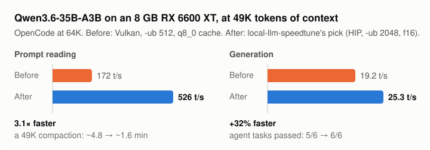

# llamacpp-speedtune

**Make llama.cpp faster for your coding agent.** An agent skill that has your coding agent (Claude Code, OpenCode, Codex, …) find the best backend and flags for *your* hardware, measured at the context depths agents really use, then checked on real agent tasks before anything is applied.

<p align="center"></p>

Most tuning advice is measured on an empty context with one short prompt. Coding agents don't work like that: every turn resends 12K+ tokens of system prompt and tools plus the whole conversation, and they compact near the end of the context. A config that wins at depth 0 can lose badly at 48K. This skill measures at your agent's real context depths, confirms that configs fit in a real server, and checks the result on real agent tasks.

It tunes **llama.cpp** (`llama-server`) on any of its backends: CUDA, HIP/ROCm, Vulkan, Metal. Ollama users can take the result with them: see [Ollama](#ollama).

## Start with the 2-minute check

No setup, no benchmarks, nothing changed. It reads your current settings and points out likely speed left on the table:

```bash
git clone https://github.com/cliffkoome/llamacpp-speedtune && cd llamacpp-speedtune/scripts
./quick_check.py --router http://127.0.0.1:8080          # a llama-server router (key from $LLAMA_API_KEY)
./quick_check.py --preset ~/models/presets.ini           # or a presets file
./quick_check.py --args "-m model.gguf -c 32768 -ngl 99"  # or one command line
```

```text
== qwen3.6-35b-a3b  (qwen35moe, MoE 8/256 experts, 40 layers, 20.6 GB)
   [big   ] Small batch size with experts in RAM
            With CPU experts, ubatch 512 -> 2048 nearly doubled prompt speed in the worked example ...
            fix: ubatch-size = 2048 and batch-size = 2048, if VRAM allows
```

The findings are rules of thumb. A tune measures what they're really worth on your machine.

## Tune: one prompt

Paste this into your coding agent. It installs the skill and runs everything itself:

```text
Install the agent skill from https://github.com/cliffkoome/llamacpp-speedtune (clone it into your skills folder, or into
~/llamacpp-speedtune and read its SKILL.md if you don't support skills). Then use it to tune my local models.
Start with the hardware inventory, then tell me what you found, the quick and comprehensive options,
and how long each would take on my machine. After I pick one, run it autonomously to the end.
Only stop to ask before using sudo, building software, or changing my live server or agent config.
```

> **Run it from an agent that isn't using the models being tuned.** Tuning needs the whole GPU, so the skill unloads your live server's models. If your agent runs on one of them (for example OpenCode on your local Qwen), the tune would stop the agent itself. Use an agent on a cloud model (Claude Code, Codex, or OpenCode with a cloud provider), or run the scripts yourself. The skill checks for this and stops instead of unloading its own model.

## Three modes

| | **Check** | **Quick tune** (default) | **Comprehensive tune** |
|---|---|---|---|
| For | Seeing if tuning is worth it | A big, safe win in about an hour | The best config your hardware can do, with evidence |
| Does | Reads your current flags and hardware; rule-of-thumb findings; changes nothing | Uses your existing llama.cpp build; sweeps batch size and cache type at your agent's max context; finds the MoE offload that fits; confirms in a real server; 2 short agent tasks per model to catch models that can't use tools | Everything: builds and compares every backend, all sweeps at 3–4 depths, speculative decoding, recorded-session replay, all 6 agent tasks before vs after |
| Time | **~2 min**, GPU stays free | **20–40 min per model** (45–90 min for 2–3 models) | **1.5–3 h per model** (5–10 h for 3–4 models: run it overnight) |

**Before a tune runs, the agent tells you the estimate for your machine and waits for your OK.** Your GPU (and any model server you run) is busy for the whole run. A quick tune can be upgraded to comprehensive later without redoing its work.

## What your agent will do

1. **Inventory:** GPU, VRAM, CPU cores, RAM size/speed/channels, PCIe link, llama.cpp builds, GGUF models (and whether they fit), Ollama. Flags hardware limits such as a single RAM stick or a narrow PCIe slot before tuning.
2. **Agent profile:** your agent's real context range, e.g. OpenCode at 64K lives between ~12K and ~49.5K tokens.
3. **Backend check:** CUDA / HIP / Vulkan / Metal built from the same commit, compared per model.
4. **Sweeps:** batch sizes, KV cache type, MoE expert offload, threads, at those depths.
5. **Real-server check:** the winners at full context, to confirm they fit.
6. **Speculative decoding:** MTP/assistant drafts and n-gram speculation, kept only if they help on real tasks.
7. **End-to-end:** 6 coding tasks run headless through your agent (fix a failing test, add a feature with tests, multi-file rename, stack-trace fix, read-then-edit, a long audit that pushes toward compaction), baseline vs tuned.
8. **Apply and document:** router presets (one server, many models, each on its best backend), or Ollama settings, plus a results report. It asks before touching services or using sudo.

## Example result (RX 6600 XT 8 GB, Ryzen 7 5700X, 32 GB)

Qwen3.6-35B-A3B (MoE) for OpenCode at 64K context, measured at 49K tokens (the compaction point):

| | Backend | Key flags | Prompt | Generation |
|---|---|---|---|---|
| Before | Vulkan | `--n-cpu-moe 33`, `-ub 512`, q8_0 cache | 172 t/s | 19.2 t/s |
| After | HIP (ROCm) | `--n-cpu-moe 34`, `-ub 2048`, f16 cache, `-t 8` | **526 t/s** | **25.3 t/s** |

That's 3× faster prompt reading (a 49K compaction drops from ~4.8 to ~1.6 minutes) and 32% faster generation. The tuned config passed 6/6 agent tasks. On the same machine, Gemma-4 12B only fit on **Vulkan** and dense 7B models generated faster on Vulkan, so one router serves each model on its best backend. Full write-up: [`references/example-rx6600xt.md`](references/example-rx6600xt.md).

## Community results

Configs from other machines: [`community/`](community/README.md). Find hardware like yours and start from its flags.

**Ran a tune? [Share your results](https://github.com/cliffkoome/llamacpp-speedtune/issues/new?template=share-results.yml)**. It's a short form, and your agent can fill it in from its results file. NVIDIA, Apple and Intel results are especially welcome: those paths haven't been run end to end yet.

## Install

As a skill (Claude Code, OpenCode and other agents that read `SKILL.md`):
```bash
npx skills add cliffkoome/llamacpp-speedtune
# or manually
git clone https://github.com/cliffkoome/llamacpp-speedtune ~/.agents/skills/llamacpp-speedtune
ln -s ~/.agents/skills/llamacpp-speedtune ~/.claude/skills/llamacpp-speedtune   # Claude Code
```
Then ask your agent: *"Tune my local models for OpenCode"*, or use a ready-made prompt from [`PROMPTS.md`](PROMPTS.md) (2-minute check, full tune, re-check after an update, add one model, diagnose a slow model, measure only).

Without skill support: clone the repo, open your agent in it, and say *"Read SKILL.md and follow it."*

## Ollama

Ollama runs llama.cpp underneath but exposes fewer settings. Tune with `llama-server` (Ollama's model files are plain GGUFs), then carry the result over:

```bash
./scripts/to_ollama.py --preset ~/models/presets.ini --model qwen3.6-35b-a3b
```

It prints a Modelfile (`num_ctx`, `num_gpu`, `num_thread`, `num_batch`), the service environment (`OLLAMA_FLASH_ATTENTION`, `OLLAMA_KV_CACHE_TYPE`, `OLLAMA_NUM_PARALLEL`), how to apply them, and **what Ollama can't do**, such as expert-only offload for MoE models or choosing a backend per model. Measure afterwards. For big MoE models, plain `llama-server` is often much faster.

## Tested on
The full workflow has been run end to end on **Linux with an AMD GPU** (RX 6600 XT 8 GB, ROCm/HIP and Vulkan) with OpenCode as the agent. The NVIDIA (CUDA), Apple (Metal) and Intel paths follow llama.cpp's documentation but **haven't been run yet**. Expect rough edges there, and please open an issue with what you hit. Other agents need an adapter in `scripts/bench_agentic.py` for the end-to-end tasks; everything else is agent-independent.

## Requirements
- Linux or macOS, Python 3.10+, bash, git.
- llama.cpp (`llama-server`, `llama-bench`). The skill can build backends for you (with your approval).
- For the agentic tests: [OpenCode](https://opencode.ai) and a Python venv with `pytest`. Other agents can be added through the adapter in `scripts/bench_agentic.py`.
- An agent that doesn't depend on the models being tuned (see the note under "Tune: one prompt").

## Layout
| Path | What |
|---|---|
| `SKILL.md` | The workflow your agent follows |
| `PROMPTS.md` | Copy-paste prompts for common jobs |
| `references/methodology.md` | Measuring at depth, agent compaction maths, the test ladder |
| `references/flags.md` | What to set, what to sweep, router presets |
| `references/backends.md` | Build recipes (CUDA, HIP, Vulkan, Metal, combined), AMD override table, Ollama |
| `references/gotchas.md` | Pitfalls that silently corrupt results |
| `references/example-rx6600xt.md` | A complete worked example |
| `scripts/` | `quick_check.py`, `init_config.py`, `detect_hw.sh`, `micro.py`, `table.py`, `validate_fill.py`, `bench_agentic.py`, `bench_replay.py`, `bench_general.py`, `to_ollama.py`, plus helpers (`server.py`, `hw.py`, `gguf_meta.py`) |
| `agentic/` | The test project, its 6 tasks and hidden checks |
| `community/` | Shared results from other machines |
| `tests/` | Unit tests for the scripts (`pytest tests`) |
| `config.example.json` | Models, backends, test port |

## Running scripts yourself
```bash
cd scripts
./init_config.py --out ../config.json      # finds your llama.cpp builds, backends and GGUF models
export TUNE_CONFIG=$PWD/../config.json      # review it first: ctx, router_url, agent.self_model
./detect_hw.sh ~/models
./micro.py vulkan C1-mymodel mymodel -ngl 99 -fa 1 -p 4096 -n 128 -d 0,16384,32768 -r 1
./table.py C1-
./validate_fill.py mymodel vulkan try1 12000,25000,49000 -ngl 99 -c 65536 -fa on -ub 2048
RECORD=1 ./bench_agentic.py mymodel vulkan tuned 1 -ngl 99 -c 65536 -fa on -ub 2048
```
Every script prints its usage when run without arguments.

## Adding another agent
In `scripts/bench_agentic.py`, write a `run_<agent>(workdir, prompt, alias, ctx, env, tmp)` that runs the agent non-interactively in `workdir` against `http://127.0.0.1:<port>/v1`, plus a `summarize_<agent>(log)`. Then register both in `ADAPTERS`. Read `references/gotchas.md` first: headless agents have surprising ways of working in the wrong directory.

## License
MIT
